<div align="center">

# NO TIME Creative House

**A bilingual (English / Arabic) website for a Dubai events and creative production house.**

[](https://nextjs.org)
[](https://www.typescriptlang.org)
[](https://tailwindcss.com)
[](https://github.com/beshoynady/notime-website/actions/workflows/ci.yml)
[](https://notime-website-ashen.vercel.app/)

**Live preview:** [notime-website-ashen.vercel.app](https://notime-website-ashen.vercel.app/)
&nbsp;·&nbsp; **Production:** notimehub.com *(at launch)*

<!-- At launch: replace the line above with [notimehub.com](https://notimehub.com) -->

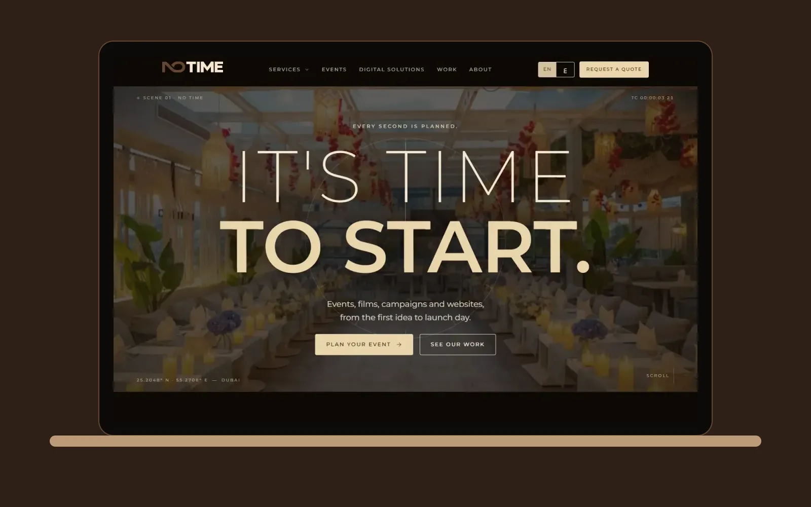

</div>

---

## Scroll-driven scenes

Each service page opens on a photo scene built in layers: the room at night, the room lit, then framed details. The layers move at different depths as you scroll.

<p align="center">
  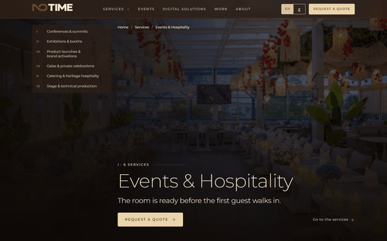
</p>

## Screenshots

| | English | Arabic (RTL) |
|---|---|---|
| **Home · 1440** | 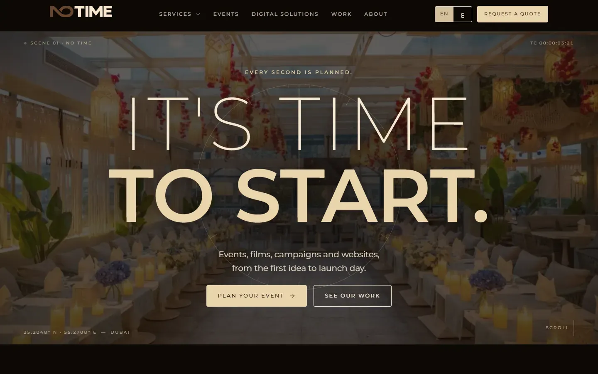 | 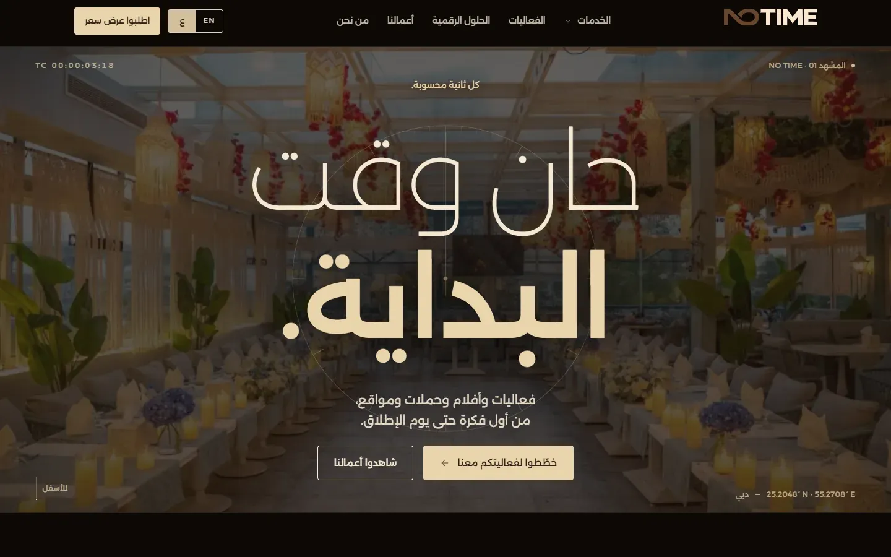 |
| **Events · 1440** | 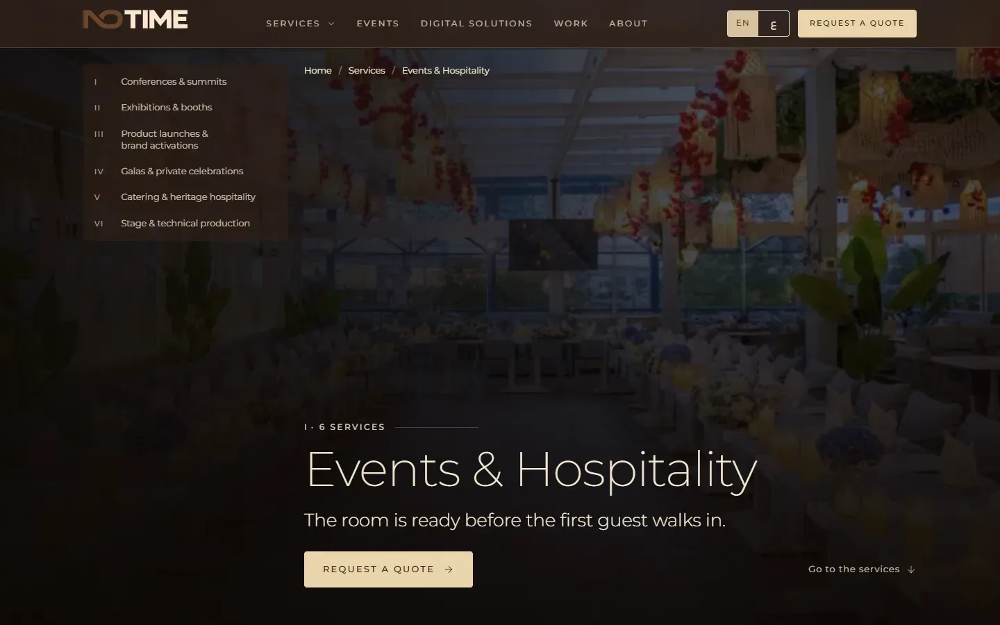 | 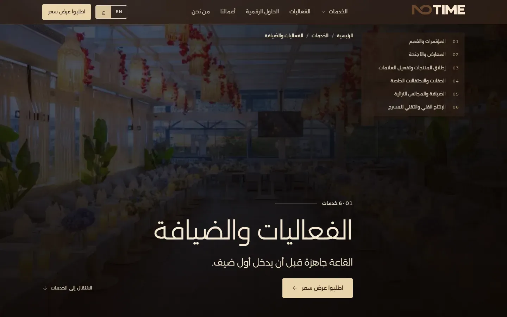 |
| **Work · 1440** | 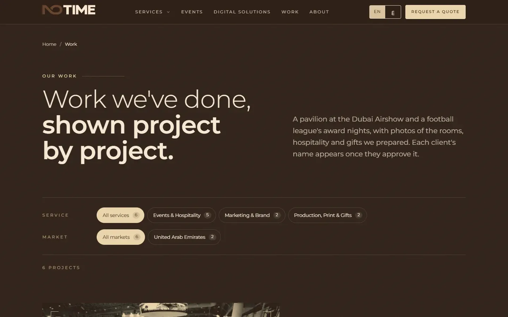 | 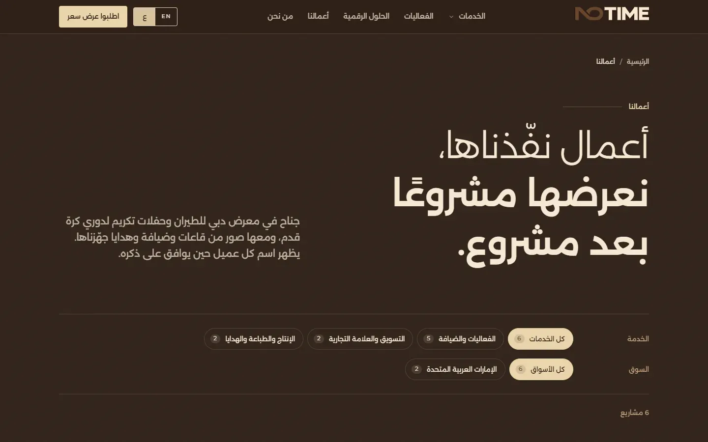 |

<table>
  <tr>
    <th>Home · 390 · EN</th><th>Home · 390 · AR</th>
    <th>Events · 390 · EN</th><th>Events · 390 · AR</th>
    <th>Work · 390 · EN</th><th>Work · 390 · AR</th>
  </tr>
  <tr>
    <td>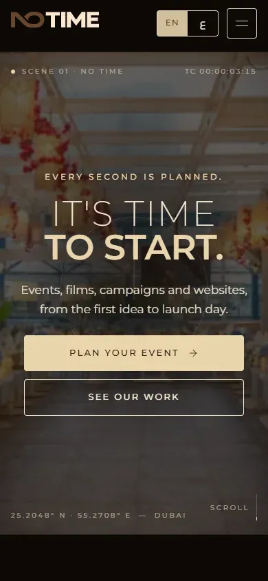</td>
    <td>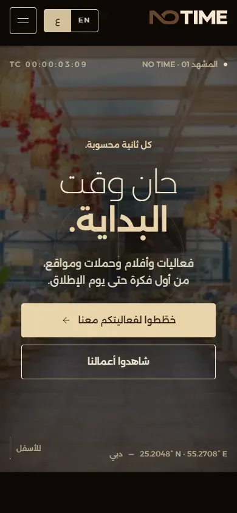</td>
    <td>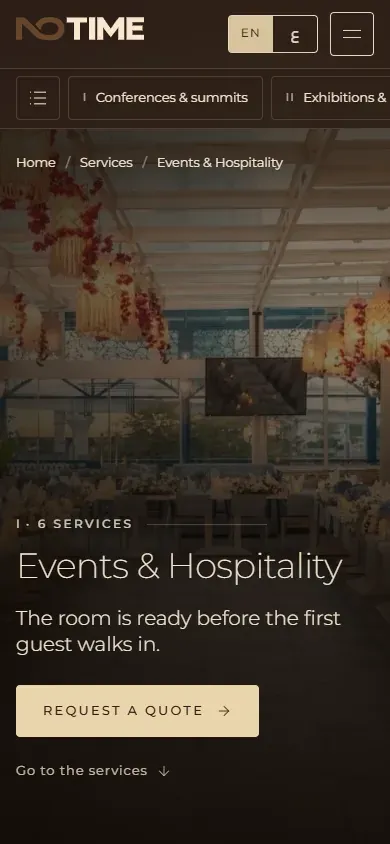</td>
    <td>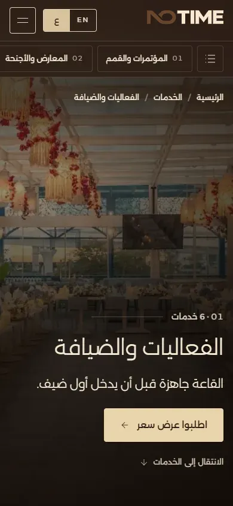</td>
    <td>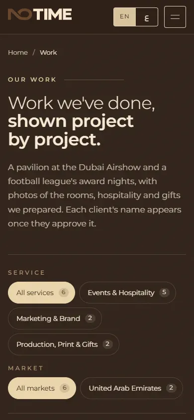</td>
    <td>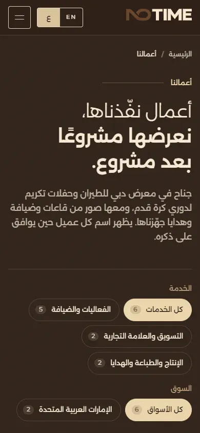</td>
  </tr>
</table>

## Features

- **Bilingual with full RTL.** English at `/en` and Arabic at `/ar`. The Arabic copy is written natively rather than translated word for word. Layout uses logical properties only, so the page mirrors cleanly; directional icons flip, and marquees and horizontal tracks reverse.
- **Layered photo scenes.** Each category page opens on a scene built in depths. The scenes pin and scrub on desktop and play as you pass on phones.
- **Secure request forms.** Quote and contact forms are validated with Zod on both the client and the server, protected by Cloudflare Turnstile (fail-closed in production), and delivered with Resend using React Email templates. Phone numbers are checked with libphonenumber-js.
- **Accessibility.** axe-core (WCAG 2.0/2.1 A and AA) reports no violations on twelve pages in both languages at 1440px and 390px.
- **Performance.** No layout shift on load: the CI suite fails if CLS reaches 0.001 (English) or 0.002 (Arabic), and if a ScrollTrigger refresh moves anything. The first screen is designed so the largest contentful paint is text, not an image. Images go through `next/image` (AVIF/WebP, lazy below the fold).
- **Reduced motion respected.** With `prefers-reduced-motion`, every scene shows its final state with no movement.
- **Central image registry.** Every photo is listed once in `src/content/media.ts` with its source, credit, licence and alt text in both languages. A unit test fails if any photo appears in two places on the site, so replacing an image is a one-line change.

## Tech stack

| Technology | Role |
|---|---|
| **Next.js 16** (App Router) | Routing, server components, static generation, server actions for the forms |
| **TypeScript** | Types across the app, the content layer and the tests |
| **Tailwind CSS v4** | Styling with design tokens and logical (RTL-safe) properties |
| **next-intl** | Locale routing, messages and formatting for English and Arabic |
| **GSAP + ScrollTrigger** | Everything driven by the scroll: pinned scenes, scrubbed layers, text reveals |
| **Motion** | Hover, tap and layout micro-interactions |
| **Lenis** | Smooth scrolling, kept in sync with ScrollTrigger |
| **React Hook Form** | Form state and field-level validation on the client |
| **Zod** | One schema per form, shared by the client and the server action |
| **Resend** + React Email | Delivering form submissions and the auto-reply |
| **Cloudflare Turnstile** | Bot protection on every form |
| **libphonenumber-js** | International phone number validation |
| **Vitest** | Unit tests for pure logic and content rules |
| **Playwright** | End-to-end tests on desktop and mobile |
| **GitHub Actions** | CI: lint, typecheck and unit tests on every push; build and the full e2e suite on pull requests to `main` |

## Engineering highlights

- **Internationalisation and RTL.** Locale-aware routing, a mirrored layout and two font stacks: Montserrat for English, Alexandria for Arabic, subset for Arabic glyphs.
- **Scroll-linked motion.** A data-driven scene engine: each scene is a config of shots and layers, and GSAP is scoped per component with `useGSAP` for clean unmounts.
- **Performance and Core Web Vitals.** Font fallbacks are matched to avoid a swap shift, plus image budgets, lazy media and client-only animation code.
- **Accessibility.** Keyboard-reachable navigation, semantic forms with accessible errors, contrast-checked tokens and reduced-motion variants.
- **Automated testing.** 497 unit tests in 74 files (Vitest), and 1,010 end-to-end tests in 49 specs across a desktop and a mobile project (Playwright). They cover forms and validation, anchors and navigation, RTL mirroring, layout shift, empty screens and content rules.
- **CI/CD.** GitHub Actions, with Vercel preview deployments on every push.

## Project structure

```
src/
  app/[locale]/        Localised routes (en, ar), layouts, Open Graph images
  app/actions/         Server actions for the forms
  components/          Layout, sections, scenes, forms, UI primitives, motion wrappers
  content/             Typed content: services, work, products, image registry, scenes
  config/              Contact details, social links and site settings in one place
  emails/              React Email templates
  i18n/                next-intl routing and request config
  lib/                 Pure logic (scroll maths, validation, formatting), with unit tests
  messages/            en.json and ar.json
public/images/         Brand, work, services and stock photography
e2e/                   Playwright specs
scripts/               Image processing, screenshots and audit tools
docs/                  Project documentation and README assets
```

## Running locally

**Requirements:** Node.js 22 (see `.nvmrc`) and npm.

```bash
npm install
cp .env.example .env.local   # then fill in the values you need
npm run dev                  # http://localhost:3000
```

| Command | What it does |
|---|---|
| `npm run dev` | Development server |
| `npm run build` | Production build |
| `npm start` | Serve the production build |
| `npm run lint` | ESLint |
| `npm run typecheck` | Route types and `tsc --noEmit` |
| `npm test` | Unit tests (Vitest) |
| `npm run e2e` | End-to-end tests (Playwright) against a running build |

### Environment variables

Names only; see `.env.example` for what each one does.

| Variable | Used for |
|---|---|
| `RESEND_API_KEY` | Sending form emails |
| `CONTACT_TO_EMAIL` | Where form submissions are delivered |
| `MAIL_FROM` | Sender address of the auto-reply |
| `NEXT_PUBLIC_TURNSTILE_SITE_KEY` | Turnstile widget (public) |
| `TURNSTILE_SECRET_KEY` | Turnstile server-side verification |
| `NEXT_PUBLIC_SITE_URL` | Public origin for canonical URLs and the sitemap |
| `NEXT_PUBLIC_WHATSAPP_NUMBER` | WhatsApp button |
| `MAIL_SINK` | Tests only: write emails to files instead of sending |

Without Turnstile keys, development and tests use Cloudflare's test keys. A production build without real keys refuses every form submission.

## Deployment

- **Preview:** Vercel. Every push gets its own preview URL.
- **Production:** Hostinger, at notimehub.com (at launch).

## Credits

- **Client:** NO TIME Creative House, Dubai.
- **Photography:**
  - The client's own project photos, supplied by the client.
  - Stock photos from [Unsplash](https://unsplash.com) ([Unsplash License](https://unsplash.com/license)) and [Pexels](https://www.pexels.com) ([Pexels License](https://www.pexels.com/license/)).
  - Each stock photo's photographer and source page are listed in `src/content/media.ts`.

## License

© NO TIME Creative House. All rights reserved. This is a private client project. The code, copy, brand and photographs may not be reused without written permission.

## Developer

Designed and built by **Beshoy Nady**. [GitHub](https://github.com/beshoynady) · LinkedIn: *(link to come)*

<!-- LinkedIn: replace "(link to come)" with [LinkedIn](https://www.linkedin.com/in/...) -->

---

<div dir="rtl">

## نبذة بالعربية

موقع ثنائي اللغة (العربية والإنجليزية) لشركة NO TIME Creative House في دبي، المتخصصة في تنظيم الفعاليات والضيافة والإنتاج الإبداعي والتسويق والطباعة والحلول الرقمية.

- **العربية أصيلة:** النصوص العربية مكتوبة مباشرة، لا مترجمة حرفيًا، والتصميم ينعكس بالكامل من اليمين إلى اليسار.
- **مشاهد بالصور:** تتحرك طبقاتها مع التمرير، وتظهر ثابتة لمن فعّل تقليل الحركة.
- **نماذج طلب آمنة:** تحقق من البيانات، وحماية من الرسائل الآلية، وإرسال بالبريد.
- **سهولة الوصول:** فحص axe بلا مخالفات على صفحات الموقع الرئيسية باللغتين.
- **بلا اهتزاز:** لا تتحرك عناصر الصفحة أثناء التحميل.

**المعاينة:** [notime-website-ashen.vercel.app/ar](https://notime-website-ashen.vercel.app/ar)

تصميم وتطوير: **بيشوي نادي**

</div>
