# صور تحتاج مراجعة راند

يُولَّد هذا الملف من سجل الصور (`src/content/media.ts`) بالأمر `node --no-warnings --import ./scripts/lib/alias.mjs scripts/images-for-rand.mjs`. لا تعدّلوه يدويًا.

**ما المطلوب من راند:** لكل صورة: «نعم، تُعرض» أو «لا، تُخفى». والصور المؤقتة: إرسال صورة حقيقية من أعمالكم بالمواصفة المكتوبة، إن وُجدت.

**كيف نخفي صورة:** سطر واحد في `src/content/media.ts`: `hidden: true`. يختفي المشهد أو الصورة من كل الصفحات دون فراغ.

## الصور (39)

| الصورة | المعرّف | المصدر | لماذا تحتاج المراجعة | المواصفة | أين تظهر |
|---|---|---|---|---|---|
| 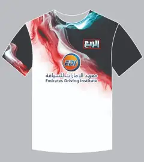 | `gifts-2` | الملف التعريفي | يظهر فيها شعار عميل أو اسمه: هل نعرضها؟ (السؤال 4) | portrait · the garment flat or on a form, the print readable | content/service-visuals.ts، content/work.ts |
|  | `uae-pro-league-1` | الملف التعريفي | يظهر فيها شعار عميل أو اسمه: هل نعرضها؟ (السؤال 4) | 16:9 · the event identity in place at the venue | content/scenes/events-hospitality.ts |
|  | `uae-pro-league-2` | الملف التعريفي | يظهر فيها شعار عميل أو اسمه: هل نعرضها؟ (السؤال 4) | 16:9 · the ceremony wide, people far off | content/scenes/events-hospitality.ts، content/work.ts |
| 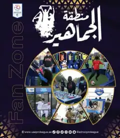 | `uae-pro-league-3` | الملف التعريفي | يظهر فيها شعار عميل أو اسمه: هل نعرضها؟ (السؤال 4) | portrait · one real post as published | content/categories.ts |
| 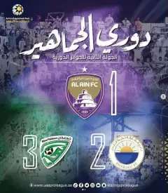 | `uae-pro-league-4` | الملف التعريفي | يظهر فيها شعار عميل أو اسمه: هل نعرضها؟ (السؤال 4) | portrait · one real post as published | content/scenes/marketing-brand.ts |
| 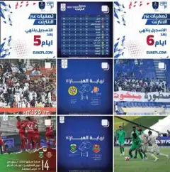 | `uae-pro-league-6` | الملف التعريفي | يظهر فيها شعار عميل أو اسمه: هل نعرضها؟ (السؤال 4) | 1:1 · the league's feed as published (players and fans far off) | content/service-visuals.ts |
| 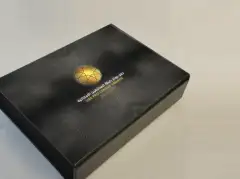 | `uae-pro-league-7` | الملف التعريفي | يظهر فيها شعار عميل أو اسمه: هل نعرضها؟ (السؤال 4) | 4:3 · the award box, cropped clear of the profile's baked-in badge and label | content/service-visuals.ts، content/work.ts |
| 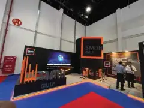 | `smith-gulf-1` | الملف التعريفي | يظهر فيها شعار عميل أو اسمه: هل نعرضها؟ (السؤال 4) | 4:3 · small (497px): a strip tile only; originals wanted (OQ #21) | content/galleries.ts |
|  | `uae-pro-league-5` | الملف التعريفي | يظهر فيها شعار عميل أو اسمه: هل نعرضها؟ (السؤال 4) | 3:2 · the set laid out, top-down or three-quarter | content/service-visuals.ts، content/work.ts |
|  | `egyptair-pavilion-1` | الملف التعريفي | يظهر فيها شعار عميل أو اسمه: هل نعرضها؟ (السؤال 4) | 3:2 · the pavilion wide; originals above 1600px wanted (OQ #21) | content/galleries.ts، content/scenes/events-hospitality.ts، content/work.ts |
|  | `sandoz-1` | الملف التعريفي | يظهر فيها شعار عميل أو اسمه: هل نعرضها؟ (السؤال 4) | portrait · the stand front on, empty or before doors open | content/galleries.ts، content/scenes/events-hospitality.ts |
| 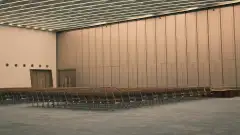 | `ev-conf-rows` | ستوك (Unsplash) | صورة مؤقتة: نحتاج صورة حقيقية من أعمالكم لهذا المشهد | 16:9 + 9:16 · a large conference hall, chairs in exact rows, nobody yet; a real NO TIME summit hall replaces it | content/scenes/events-hospitality.ts |
| 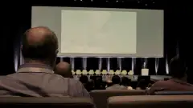 | `ev-conf-session` | ستوك (Unsplash) | صورة مؤقتة: نحتاج صورة حقيقية من أعمالكم لهذا المشهد | 16:9 + 9:16 · a session running, the audience from behind, the stage and screen lit | content/scenes/events-hospitality.ts |
| 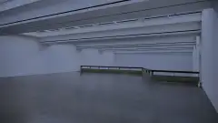 | `ev-exh-hall` | ستوك (Unsplash) | صورة مؤقتة: نحتاج صورة حقيقية من أعمالكم لهذا المشهد | 16:9 + 9:16 · an empty exhibition hall the night before doors open, bare floor, no stands or logos | content/scenes/events-hospitality.ts |
| 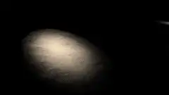 | `ev-launch-spot` | ستوك (Unsplash) | صورة مؤقتة: نحتاج صورة حقيقية من أعمالكم لهذا المشهد | 16:9 + 9:16 · a dark stage, one pool of light, seconds before a reveal | content/scenes/events-hospitality.ts |
| 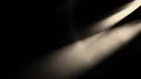 | `ev-stage-beams` | ستوك (Unsplash) | صورة مؤقتة: نحتاج صورة حقيقية من أعمالكم لهذا المشهد | 16:9 + 9:16 · the first beams through haze in a dark hall (a NO TIME rig at first light replaces it) | content/scenes/events-hospitality.ts |
| 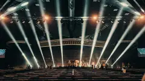 | `ev-stage-live` | ستوك (Unsplash) | صورة مؤقتة: نحتاج صورة حقيقية من أعمالكم لهذا المشهد | 16:9 + 9:16 · the full rig on, the seated audience from behind, no faces | content/scenes/events-hospitality.ts |
| 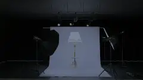 | `cp-open-dark` | ستوك (Unsplash) | صورة مؤقتة: نحتاج صورة حقيقية من أعمالكم لهذا المشهد | 16:9 + 9:16 · a studio before the lights: the white sweep, stands and rails, no people (a NO TIME set replaces it) | content/scenes/creative-production.ts |
| 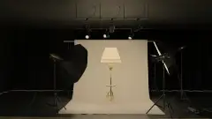 | `cp-open-lit` | ستوك (Unsplash) | صورة مؤقتة: نحتاج صورة حقيقية من أعمالكم لهذا المشهد | 16:9 + 9:16 · the same studio with its key light on; same frame as cp-open-dark | content/scenes/creative-production.ts |
| 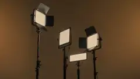 | `cp-rental-lights` | ستوك (Unsplash) | صورة مؤقتة: نحتاج صورة حقيقية من أعمالكم لهذا المشهد | 16:9 · lights on stands against a plain wall, no brand marks (NO TIME's own kit replaces it) | content/service-visuals.ts |
| 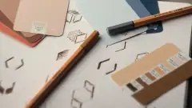 | `mb-open-desk` | ستوك (Unsplash) | صورة مؤقتة: نحتاج صورة حقيقية من أعمالكم لهذا المشهد | 16:9 + 9:16 · a designer's desk: swatches, sketches and pens, cropped past a printed box (a NO TIME desk replaces it) | content/scenes/marketing-brand.ts |
| 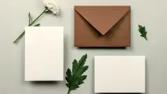 | `mb-branding` | ستوك (Unsplash) | صورة مؤقتة: نحتاج صورة حقيقية من أعمالكم لهذا المشهد | 16:9 · blank stationery and an envelope, ready for an identity (NO TIME's printed identity work replaces it) | content/service-visuals.ts |
| 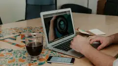 | `mb-digital` | ستوك (Unsplash) | صورة مؤقتة: نحتاج صورة حقيقية من أعمالكم لهذا المشهد | 16:9 · hands at a laptop on a meeting table, no legible data | content/service-visuals.ts |
| 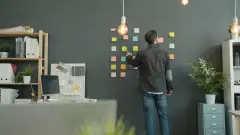 | `mb-content` | ستوك (Unsplash) | صورة مؤقتة: نحتاج صورة حقيقية من أعمالكم لهذا المشهد | 16:9 · a plan on sticky notes on a studio wall, seen from behind | content/service-visuals.ts |
| 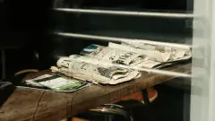 | `mb-pr` | ستوك (Unsplash) | صورة مؤقتة: نحتاج صورة حقيقية من أعمالكم لهذا المشهد | 16:9 · newspapers on a table by a window, no legible mastheads | content/service-visuals.ts |
|  | `mb-paid` | ستوك (Unsplash) | صورة مؤقتة: نحتاج صورة حقيقية من أعمالكم لهذا المشهد | 16:9 · a phone in hand scrolling a feed at a desk | content/service-visuals.ts |
| 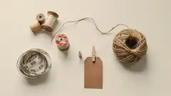 | `pg-open-materials` | ستوك (Unsplash) | صورة مؤقتة: نحتاج صورة حقيقية من أعمالكم لهذا المشهد | 16:9 · twine, ribbon spools and a kraft tag on a pale bench (NO TIME's own materials replace it) | content/scenes/production-print-gifts.ts |
| 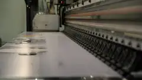 | `pg-open-press` | ستوك (Unsplash) | صورة مؤقتة: نحتاج صورة حقيقية من أعمالكم لهذا المشهد | 16:9 + 9:16 · a large-format printer running sheets (NO TIME's print partner's floor replaces it) | content/scenes/production-print-gifts.ts |
| 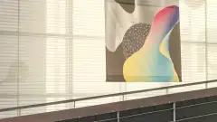 | `pg-printing` | ستوك (Unsplash) | صورة مؤقتة: نحتاج صورة حقيقية من أعمالكم لهذا المشهد | 16:9 · a printed banner hung in a bright hall, no text | content/service-visuals.ts |
| 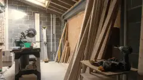 | `pg-fabrication` | ستوك (Unsplash) | صورة مؤقتة: نحتاج صورة حقيقية من أعمالكم لهذا المشهد | 16:9 · a carpentry workshop: timber, a saw and tools, no people | content/service-visuals.ts |
| 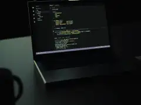 | `sw-websites` | ستوك (Unsplash) | صورة مؤقتة: نحتاج صورة حقيقية من أعمالكم لهذا المشهد | 4:3 · a laptop showing code on a dark desk, no legible brand | content/software/page.ts |
| 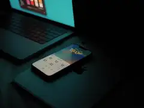 | `sw-apps` | ستوك (Unsplash) | صورة مؤقتة: نحتاج صورة حقيقية من أعمالكم لهذا المشهد | 4:3 · a phone resting on a laptop, lock screen only | content/software/page.ts |
| 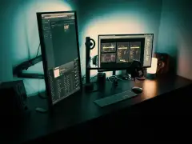 | `sw-systems` | ستوك (Unsplash) | صورة مؤقتة: نحتاج صورة حقيقية من أعمالكم لهذا المشهد | 4:3 · two monitors with dashboards at a desk, no legible data | content/software/page.ts |
| 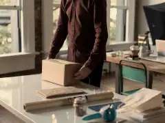 | `sw-ecommerce` | ستوك (Unsplash) | صورة مؤقتة: نحتاج صورة حقيقية من أعمالكم لهذا المشهد | 4:3 · an order packed at a bright table, the face out of frame | content/software/page.ts |
| 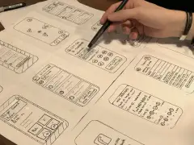 | `sw-ux` | ستوك (Unsplash) | صورة مؤقتة: نحتاج صورة حقيقية من أعمالكم لهذا المشهد | 4:3 · app wireframes sketched on paper, a hand with a pen | content/software/page.ts |
| 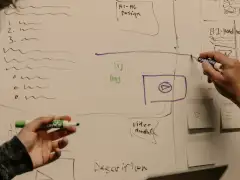 | `sw-ai` | ستوك (Unsplash) | صورة مؤقتة: نحتاج صورة حقيقية من أعمالكم لهذا المشهد | 4:3 · a process mapped on a whiteboard, hands only | content/software/page.ts |
| 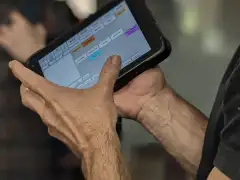 | `sw-event-tech` | ستوك (Unsplash) | صورة مؤقتة: نحتاج صورة حقيقية من أعمالكم لهذا المشهد | 4:3 · hands on a rugged tablet on an event floor, no faces | content/software/page.ts |
| 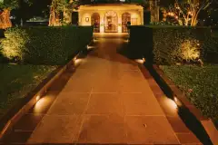 | `pp-minute-zero` | ستوك (Unsplash) | صورة مؤقتة: نحتاج صورة حقيقية من أعمالكم لهذا المشهد | 3:2 · the way in to a venue at night, lit path to an open door, no faces, no signs | content/product-pages.ts |
| 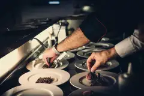 | `pp-peak-hour` | ستوك (Unsplash) | صورة مؤقتة: نحتاج صورة حقيقية من أعمالكم لهذا المشهد | 3:2 · a kitchen pass at service, hands plating, no faces | content/product-pages.ts |

## ملفات نحتاجها من راند

| ما نحتاجه | لماذا | أين سيظهر |
|---|---|---|
| ملفات الموشن جرافيك الأصلية (فيديو MP4 أو MOV، 10–20 ثانية لكل عمل) | أمثلة الموشن الوحيدة في الملف التعريفي صور ثابتة من صفحات الاتحاد، وهي مستبعدة | الإنتاج الإبداعي · الموشن جرافيك |
| أمثلة محتوى بالذكاء الاصطناعي قدّمتموها لعملاء غير الاتحاد (صور أو مقاطع) | أمثلة الملف التعريفي كلها من صفحات الاتحاد | الإنتاج الإبداعي · المحتوى بالذكاء الاصطناعي |
| مقطع فيديو قصير صامت من فعالية حقيقية (شوريل) | من يشتري فيديو يريد أن يرى فيديو | الإنتاج الإبداعي، والرئيسية |
| صور لموقع تصوير جهّزتموه، أو للاستوديو الذي تعملون فيه، دون أشخاص | افتتاحية صفحة الإنتاج الإبداعي تعرض الآن استوديو من مكتبة صور مجانية | الإنتاج الإبداعي · الافتتاحية |
| صور لمعدّات التصوير والإضاءة التي تؤجّرونها، بلا شعارات ظاهرة | قسم تأجير المعدّات يعرض الآن أجهزة إضاءة من مكتبة صور مجانية | الإنتاج الإبداعي · تأجير المعدّات |
| الصور الأصلية لجناح مصر للطيران (أعرض من 1600 بكسل) | الصورة الوحيدة في الملف عرضها 751 بكسل، فلا تصلح إلا بطاقة صغيرة | الأعمال، والرئيسية |
| صور أجنحة Smith Gulf بدقة أعلى | صور الملف أصغر من 500 بكسل | الإنتاج والطباعة · تصنيع الأجنحة |
| صورة واضحة لصندوق جوائز دوري المحترفين دون علامة «2 of 3» | العلامة مطبوعة داخل صورة الملف | الإنتاج والطباعة · التغليف |
| صور لهويات صمّمناها مطبوعة على أوراق ومطبوعات حقيقية | قسم الهوية يعرض الآن صورة مخزون لأوراق فارغة | التسويق · الهوية البصرية |
| صور لمكتب الفريق أثناء العمل على حملة (بلا وجوه) | افتتاحية صفحة التسويق تعرض الآن مكتبًا من صور المخزون | التسويق · الافتتاحية |
| صور لأرضية الطباعة أو الورشة أثناء العمل على طلب حقيقي | افتتاحية صفحة الإنتاج وقسما الطباعة والتصنيع تعرض الآن صور مخزون | الإنتاج والطباعة · الافتتاحية، والطباعة، والتصنيع |
| صور لشاشات من أعمالنا البرمجية الحقيقية (موقع أو تطبيق أو لوحة تحكم، بإذن العميل) | الخدمات الست في صفحة البرمجيات تعرض الآن صور أجهزة من المخزون | البرمجيات · الخدمات وتقنيات الفعاليات |
