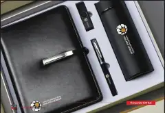
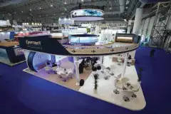
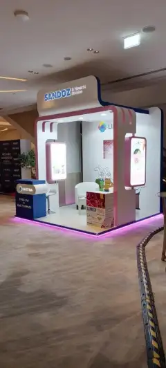

# صور تحتاج مراجعة راند

يُولَّد هذا الملف من سجل الصور (`src/content/media.ts`) بالأمر `node --no-warnings --import ./scripts/lib/alias.mjs scripts/images-for-rand.mjs`. لا تعدّلوه يدويًا.

**ما المطلوب من راند:** لكل صورة: «نعم، تُعرض» أو «لا، تُخفى». والصور المؤقتة: إرسال صورة حقيقية من أعمالكم بالمواصفة المكتوبة، إن وُجدت.

**كيف نخفي صورة:** سطر واحد في `src/content/media.ts`: `hidden: true`. يختفي المشهد أو الصورة من كل الصفحات دون فراغ.

## الصور (8)

| الصورة | المعرّف | المصدر | لماذا تحتاج المراجعة | المواصفة | أين تظهر |
|---|---|---|---|---|---|
|  | `gifts-2` | الملف التعريفي | يظهر فيها شعار عميل أو اسمه: هل نعرضها؟ (السؤال 4) | portrait · the garment flat or on a form, the print readable | غير مستخدمة بعد |
|  | `uae-pro-league-1` | الملف التعريفي | يظهر فيها شعار عميل أو اسمه: هل نعرضها؟ (السؤال 4) | 16:9 · the event identity in place at the venue | غير مستخدمة بعد |
|  | `uae-pro-league-2` | الملف التعريفي | يظهر فيها شعار عميل أو اسمه: هل نعرضها؟ (السؤال 4) | 16:9 · the ceremony wide, people far off | غير مستخدمة بعد |
|  | `uae-pro-league-3` | الملف التعريفي | يظهر فيها شعار عميل أو اسمه: هل نعرضها؟ (السؤال 4) | portrait · one real post as published | غير مستخدمة بعد |
|  | `uae-pro-league-4` | الملف التعريفي | يظهر فيها شعار عميل أو اسمه: هل نعرضها؟ (السؤال 4) | portrait · one real post as published | غير مستخدمة بعد |
|  | `uae-pro-league-5` | الملف التعريفي | يظهر فيها شعار عميل أو اسمه: هل نعرضها؟ (السؤال 4) | 3:2 · the set laid out, top-down or three-quarter | غير مستخدمة بعد |
|  | `egyptair-pavilion-1` | الملف التعريفي | يظهر فيها شعار عميل أو اسمه: هل نعرضها؟ (السؤال 4) | 3:2 · the pavilion wide; originals above 1600px wanted (OQ #21) | غير مستخدمة بعد |
|  | `sandoz-1` | الملف التعريفي | يظهر فيها شعار عميل أو اسمه: هل نعرضها؟ (السؤال 4) | portrait · the stand front on, empty or before doors open | غير مستخدمة بعد |

## ملفات نحتاجها من راند

| ما نحتاجه | لماذا | أين سيظهر |
|---|---|---|
| ملفات الموشن جرافيك الأصلية (فيديو MP4 أو MOV، 10–20 ثانية لكل عمل) | أمثلة الموشن الوحيدة في الملف التعريفي صور ثابتة من صفحات الاتحاد، وهي مستبعدة | الإنتاج الإبداعي · الموشن جرافيك |
| أمثلة محتوى بالذكاء الاصطناعي قدّمتموها لعملاء غير الاتحاد (صور أو مقاطع) | أمثلة الملف التعريفي كلها من صفحات الاتحاد | الإنتاج الإبداعي · المحتوى بالذكاء الاصطناعي |
| مقطع فيديو قصير صامت من فعالية حقيقية (شوريل) | من يشتري فيديو يريد أن يرى فيديو | الإنتاج الإبداعي، والرئيسية |
| الصور الأصلية لجناح مصر للطيران (أعرض من 1600 بكسل) | الصورة الوحيدة في الملف عرضها 751 بكسل، فلا تصلح إلا بطاقة صغيرة | الأعمال، والرئيسية |
| صور أجنحة Smith Gulf بدقة أعلى | صور الملف أصغر من 500 بكسل | الإنتاج والطباعة · تصنيع الأجنحة |
| صورة واضحة لصندوق جوائز دوري المحترفين دون علامة «2 of 3» | العلامة مطبوعة داخل صورة الملف | الإنتاج والطباعة · التغليف |
